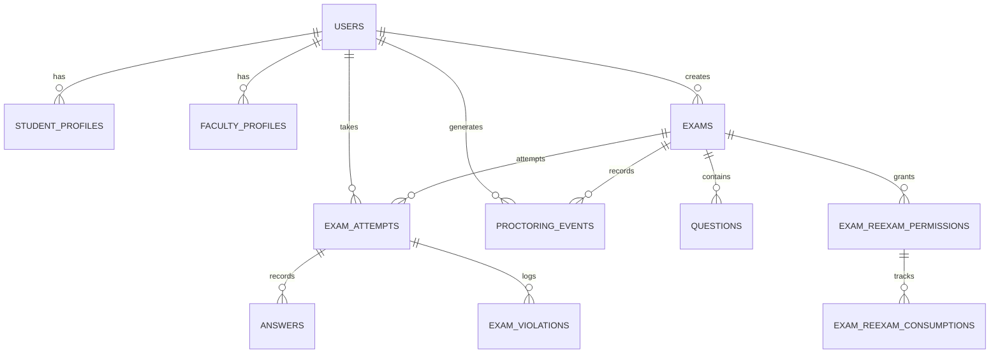

# ExamGuard AI — System Architecture & Technical Specification

ExamGuard AI is an enterprise-grade online examination platform with integrated real-time multi-modal proctoring, WebRTC live video/audio streaming, automated and manual grading pipelines, candidate identity verification, and role-based administration.

---

## 1. High-Level Architecture

```
                               ┌────────────────────────────────────────────────────────┐
                               │                    CLIENT APPLICATIONS                 │
                               │                                                        │
                               │   Student Interface        Faculty & Admin Portals     │
                               │  - Pre-exam Identity Check  - Live Integrity Grid      │
                               │  - Lockdown Test Workspace  - Exam Authoring Wizard    │
                               │  - WebRTC Video Streamer    - Evidence Review Center   │
                               │  - Real-time Violation Emit - Gradebook & Analytics    │
                               └───────────┬────────────────────────────┬───────────────┘
                                           │                            │
                                           │ HTTPS REST / WSS           │ HTTPS REST / WSS
                                           ▼                            ▼
                               ┌────────────────────────────────────────────────────────┐
                               │              EDGE / REVERSE PROXY LAYER                │
                               │        Next.js Middleware + Optional ngrok / Caddy     │
                               └───────────────────────────┬────────────────────────────┘
                                                           │
                                                           ▼
                               ┌────────────────────────────────────────────────────────┐
                               │                 FASTAPI BACKEND CORE                   │
                               │                                                        │
                               │   ┌────────────────────┐   ┌────────────────────────┐  │
                               │   │   Auth & Security  │   │  WebRTC Signaling Hub  │  │
                               │   │  - JWT & Rotation  │   │  - Candidate Rooms     │  │
                               │   │  - RBAC (3 Roles)  │   │  - Peer Offer/Answer   │  │
                               │   └────────────────────┘   │  - ICE Candidate Relay │  │
                               │   ┌────────────────────┐   └────────────────────────┘  │
                               │   │    Exam Engine     │   ┌────────────────────────┐  │
                               │   │  - Attempt Policy  │   │ Proctoring & Identity  │  │
                               │   │  - Atomic Resume   │   │  - Face Verification   │  │
                               │   │  - Re-Exam Grants  │   │  - Live Event Machine  │  │
                               │   └────────────────────┘   │  - Evidence Storage    │  │
                               │   ┌────────────────────┐   └────────────────────────┘  │
                               │   │  Grading Engine    │   ┌────────────────────────┐  │
                               │   │  - MCQ Auto-Score  │   │   Student Directory    │  │
                               │   │  - Manual Queue    │   │  - Batch Management    │  │
                               │   └────────────────────┘   │  - Bulk CSV/Excel Imprt│  │
                               │                            └────────────────────────┘  │
                               └───────────────┬─────────────────────────┬──────────────┘
                                               │                         │
                                               ▼                         ▼
                               ┌─────────────────────────┐    ┌─────────────────────────┐
                               │   PostgreSQL 16 Engine  │    │     Redis 7 / Memory    │
                               │  - Users & Profiles     │    │  - Refresh Token State  │
                               │  - Exams & Questions    │    │  - Session Revocation   │
                               │  - Attempts & Answers   │    │  - In-Memory Failover   │
                               │  - Proctoring Events    │    └─────────────────────────┘
                               │  - Re-Exam Consumptions │
                               └─────────────────────────┘
```

---

## 2. Core Subsystems

### 2.1 Authentication & Session Management
- **Token Architecture**:
  - **Access Token**: Short-lived JWT (15 minutes) signed with HS256 containing `sub` (User ID), `role`, `email`, and expiration timestamp.
  - **Refresh Token**: Long-lived JWT (7 days) with a unique `jti` (JWT ID). Stored in Redis with automatic token rotation on use.
  - **Fallback Store**: In-memory dictionary store if Redis is unavailable in local development or standalone setups.
- **Role-Based Access Control (RBAC)**:
  - Three distinct roles: `STUDENT`, `FACULTY`, `ADMIN`.
  - Enforced at the FastAPI dependency layer (`require_roles([UserRole.FACULTY])`) and Next.js Edge Middleware (`middleware.ts`).

### 2.2 Exam Authoring & Management Engine
- **Exam Configuration Wizard**:
  - Configurable title, description, duration in minutes, pass marks, and total marks.
  - **Availability Modes**: `ALWAYS` (open enrollment) or `SCHEDULED` (start and end datetime bounds).
  - **Attempt Policy**: `ONE_ATTEMPT` or `MULTIPLE_ATTEMPTS` with explicit maximum limits.
  - **Grading Policies**: Support for `NONE` or `PER_QUESTION` negative marking, auto-submit countdown timers, and question shuffling.
- **Question Authoring**:
  - **MCQ Questions**: 2 to 6 options with correct option index, custom mark weight, negative mark deductions, and detailed explanations.
  - **Short Answer Questions**: Free-text prompt with faculty reference answer and rubrics.
  - **Bulk Import**: Parser for CSV/Excel (`.xlsx`) files with schema preview and row-level validation.

### 2.3 Student Examination & Attempt Lifecycle
```
 [Student Registers / Joins]
            │
            ▼
 [Profile Verification Check] ──(Incomplete)──▶ [Redirect to Profile / Photo Setup]
            │ (Complete)
            ▼
 [Pre-Exam Instructions & Hardware Check]
            │
            ▼
 [Identity Verification Step] ──▶ Compare webcam snapshot with registered photo
            │ (Pass)
            ▼
 [Start / Resume Exam Attempt] ──▶ Atomic DB transaction + Partial Unique Index
            │
            ▼
 [Live Exam Workspace]
   ├── Fullscreen Lockdown Guard
   ├── Real-time Auto-Save Answer Pipeline
   ├── WebRTC Peer Stream to Faculty Proctor
   └── Multi-Modal Violation Detection Loop
            │
      (Submit / Timer Expiry)
            ▼
 [Automated Grading Engine] ──▶ Instant MCQ calculation & Short-Answer Manual Queue
            │
            ▼
 [Submission Summary / Gradebook]
```

- **Concurrency & Idempotency Guarantee**:
  - A PostgreSQL partial unique index `uq_exam_attempts_active_student` on `(student_id, exam_id) WHERE status = 'IN_PROGRESS'` guarantees that a candidate cannot open parallel tabs or run concurrent attempts.
  - Network disconnects or page reloads trigger the idempotent **rejoin** flow, preserving remaining time and previous answers.

### 2.4 Re-Examination Permission & Consumption Subsystem
- Faculty can grant additional exam attempts:
  - **Targeted**: Specific student receiving $N$ additional attempts.
  - **Global**: Whole-class grant allowing every enrolled student $N$ additional attempts.
- **Consumption Tracking**:
  - The `exam_reexam_consumptions` table tracks individual student consumption against global permissions. A single student cannot exhaust another student's granted attempts.

### 2.5 Real-Time Proctoring & WebRTC Media Streaming
- **Signaling Hub**:
  - WebSocket signaling router located at `/api/v1/exams/{exam_id}/ws`.
  - Connects candidates and proctor monitors using exam room identifiers.
  - Handles WebRTC signaling (`offer`, `answer`, `ice_candidate`) and candidate state sync (`student_joined`, `student_rejoined`, `violation_detected`).
- **Violation Triggers & Lockdown Overlays**:
  - **Tab Switching / Blur**: Detected via `document.visibilitychange` and `window.blur`. Triggers `ExamLockdownOverlay`.
  - **Camera Disconnect**: Monitored via WebRTC media tracks. Triggers `ExamMediaLockOverlay`.
  - **Multiple Faces / Face Absent**: Captured via continuous frame sampling (`/api/v1/proctoring/continuous-verify`).
  - **Evidence Snapshots**: Uploaded to `/uploads/` and `/proctoring-evidence/` with disk references logged in `proctoring_events`.

### 2.6 Faculty Integrity & Evidence Review Center
- **Live Candidate Monitor**:
  - Grid view of active candidates with live video streams, connection health, rejoin counters, and live violation pills.
- **Evidence Review Gallery**:
  - Search and filter by student, severity (`CRITICAL`, `HIGH`, `MEDIUM`, `LOW`), or review status (`PENDING`, `CONFIRMED`, `DISMISSED`, `FALSE_POSITIVE`).
  - Allows faculty to review captured snapshots, record verification notes, and adjust grades if necessary.

---

## 3. Database Schema Overview



---

## 4. Security & Compliance Measures

1. **Authentication Gate**: All mutating endpoints require valid Bearer JWT tokens.
2. **Media Stream Privacy**: WebRTC media feeds are direct peer-to-peer or secured through private signaling rooms; only the exam creator or administrators can join a room.
3. **Evidence Isolation**: Evidence files are stored in protected disk directories and served via authenticated FastAPI `FileResponse` endpoints that verify student/faculty ownership.
4. **Zero Test Clutter Guarantee**: Strict developer guidelines in `AGENTS.md` and automated teardowns in tests ensure no demo or dummy data persists in live or staging databases.
